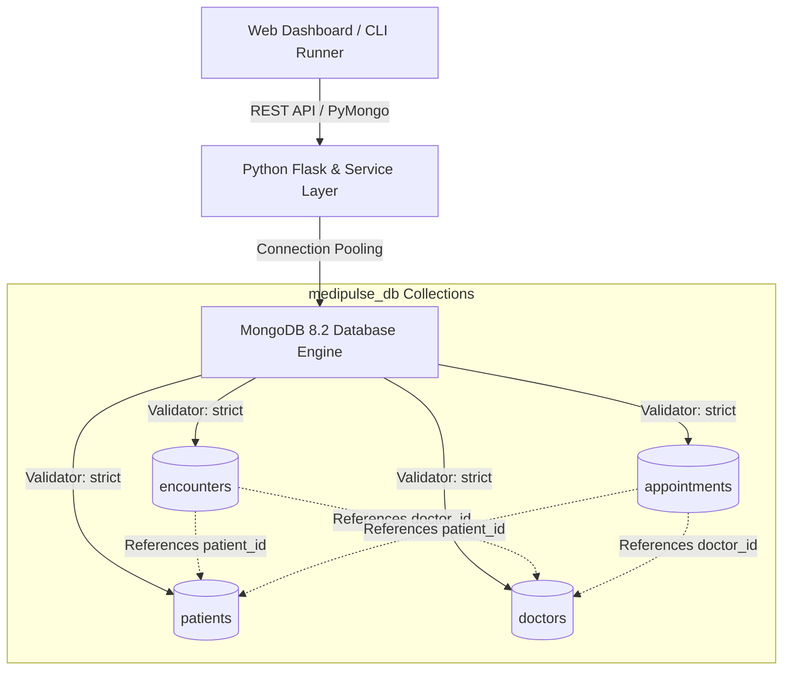
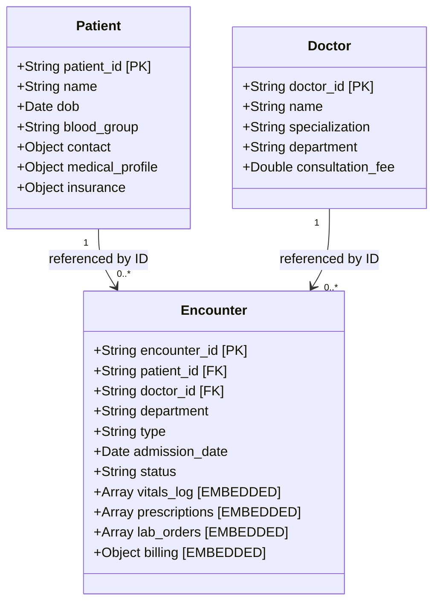

# LOVELY PROFESSIONAL UNIVERSITY
## School of Computer Science and Engineering
### Academic Task 2: Project Report
**Course Code:** CSE494  
**Course Title:** INTELLIGENT NOSQL DATABASES  
**Max Marks:** 30  
**Allotment Date:** 31st August, 2026  
**Submission Date:** 19th October, 2026  

---

# PROJECT TITLE: MediPulse EHR — Intelligent Hospital & Electronic Health Record Management Platform

---

## EXECUTIVE SUMMARY
**MediPulse EHR** is a specialized, production-ready healthcare data management system engineered using **MongoDB 8.2** and **Python 3.12 (PyMongo 4.19)**. Modern healthcare platforms deal with polymorphous, high-velocity clinical telemetry (vitals, diagnostic lab orders, prescriptions, and complex multi-specialty encounters) where traditional relational database management systems (RDBMS) suffer from rigid schemas and query degradation due to multi-table joins. 

MediPulse addresses this challenge by implementing a hybrid document model combining **atomic document embedding** for 1:Few clinical events with **clean referencing** for top-level entities (Patients, Doctors). It features database engine-level `$jsonSchema` validation, high-throughput indexing (compound, unique, and full-text search), transactional CRUD services, and 5 multi-stage clinical aggregation pipelines.

---

## 1. PROBLEM SELECTION & REAL-WORLD RELEVANCE

### 1.1 The Clinical Data Problem
In multi-specialty hospital management, patient data is inherently dynamic, semi-structured, and subject to evolving regulatory and clinical standards:
1. **Polymorphic Encounters:** An inpatient visit requires room allotment and daily vitals logs; an outpatient consultation involves quick prescriptions; an emergency encounter requires immediate triage and critical flag monitoring.
2. **High-Frequency Vitals Telemetry:** Vitals such as heart rate, blood pressure, SpO2, and temperature are recorded at variable time intervals throughout an admission. In an RDBMS, this requires constant row insertions into a separate table joined with foreign keys.
3. **Complex Prescriptions & Lab Panels:** Lab reports vary dramatically by discipline (e.g. Troponin-I biomarkers vs. Arterial Blood Gas vs. Bilateral Knee X-Rays). Normalizing these across rigid SQL tables leads to sparse columns with numerous NULL values or cumbersome Entity-Attribute-Value (EAV) anti-patterns.
4. **Data Integrity Demands:** Despite schema flexibility, clinical data demands strict integrity checks (e.g., blood group must belong to known ABO/Rh groups, billing cannot be negative, contact numbers must match telephone formats).

### 1.2 Why MongoDB & NoSQL?
| Evaluation Parameter | Relational Database (RDBMS - MySQL/PostgreSQL) | MongoDB Document Database (MediPulse) |
| :--- | :--- | :--- |
| **Data Representation** | Rigid rectangular tables with strict foreign keys | Hierarchical JSON/BSON documents |
| **Clinical Encounter Reads** | Requires 5+ table joins (`patients`, `encounters`, `vitals`, `prescriptions`, `billing`) | Single I/O disk fetch; all encounter data is co-located |
| **Write Latency & Concurrency** | Multi-table locks and foreign key resolution overhead | Atomic document writes on single collections |
| **Schema Evolution** | Requires disruptive `ALTER TABLE` DDL migrations | Flexible document structures with collection-level `$jsonSchema` |
| **Analytical Intelligence** | Complex recursive SQL queries | Native Aggregation Pipeline (`$lookup`, `$unwind`, `$facet`, `$bucket`) |

---

## 2. DATABASE & DOCUMENT DESIGN

### 2.1 Collection Overview
The database `medipulse_db` consists of 4 primary collections:
1. `patients`: Demographic profiles, emergency contacts, baseline vitals, allergies, chronic conditions, and insurance data.
2. `doctors`: Medical staff profiles, specializations, qualifications, consultation fees, and weekly availability.
3. `encounters`: Clinical encounters (Inpatient, Outpatient, Emergency), containing embedded arrays of `vitals_log`, `prescriptions`, `lab_orders`, and `billing`.
4. `appointments`: Scheduled consultations and follow-up tracking.

### 2.2 System Architecture Diagram


### 2.3 Rationale: Embedding vs. Referencing Decision Matrix



#### Why Vitals & Prescriptions are Embedded in `encounters`:
- **1:Few Cardinality:** An encounter typically has 2–20 vitals logs and 1–6 medications.
- **Bounded Growth:** When a patient is discharged, the encounter document stops growing. This eliminates the risk of exceeding MongoDB's 16MB document limit.
- **Access Locality:** A doctor reviewing a patient visit always needs the diagnosis, vitals readings, medications, and billing together in a single screen.

#### Why Patients & Doctors are Referenced:
- **1:Many Unbounded Relationship:** A patient may visit the hospital hundreds of times over their lifetime. Embedding encounters directly inside the patient document is a known anti-pattern that causes unbounded document growth and frequent memory re-allocations.
- **Entity Independence:** Doctors exist independently of individual visits and treat thousands of patients across years.

### 2.4 Indexing Strategy
To ensure low query latency ($O(\log N)$) and support aggregation pipelines, the following indexes are deployed:

| Collection | Index Fields | Index Type | Clinical / Operational Rationale |
| :--- | :--- | :--- | :--- |
| `patients` | `{"patient_id": 1}` | Unique Single Field | Primary key uniqueness; enables $O(1)$ lookup |
| `patients` | `{"blood_group": 1}` | Single Field | Rapid emergency blood donor/recipient matching |
| `patients` | `{"contact.address.city": 1, "status": 1}` | Compound Index | Regional epidemiological analysis |
| `patients` | `{"name": "text", "medical_profile.chronic_conditions": "text"}` | Text Index | Fast full-text clinical keyword search |
| `doctors` | `{"doctor_id": 1}` | Unique Single Field | Uniqueness of doctor registration ID |
| `doctors` | `{"department": 1, "active": 1}` | Compound Index | Quick departmental roster lookup |
| `encounters` | `{"encounter_id": 1}` | Unique Single Field | Encounter primary key uniqueness |
| `encounters` | `{"department": 1, "admission_date": -1}` | Compound Index | Supports Pipeline 1 sorting and filtering |
| `encounters` | `{"primary_diagnosis": "text"}` | Text Index | Diagnostic case study queries |
| `encounters` | `{"vitals_log.timestamp": -1}` | Multikey Index | Optimizes temporal queries on embedded vitals |

---

## 3. MONGODB ENGINE-LEVEL SCHEMA VALIDATION ($jsonSchema)

MediPulse enforces validation rules directly inside the MongoDB storage engine using `$jsonSchema`.
Validation settings:
- `validationLevel: "strict"` (All inserts and updates must conform)
- `validationAction: "error"` (Violations are rejected with `WriteError: Document failed validation`)

### 3.1 Patient Validation Rules
```json
{
  "$jsonSchema": {
    "bsonType": "object",
    "required": ["patient_id", "name", "gender", "blood_group", "dob", "contact"],
    "properties": {
      "patient_id": {
        "bsonType": "string",
        "pattern": "^PAT-[0-9]{4,}$",
        "description": "Must follow PAT-XXXX format"
      },
      "gender": {
        "enum": ["Male", "Female", "Other"]
      },
      "blood_group": {
        "enum": ["A+", "A-", "B+", "B-", "AB+", "AB-", "O+", "O-"]
      },
      "dob": {
        "bsonType": "date"
      },
      "contact": {
        "bsonType": "object",
        "required": ["phone", "email"],
        "properties": {
          "phone": {
            "bsonType": "string",
            "pattern": "^\\+?[0-9\\s\\-]{10,15}$"
          },
          "email": {
            "bsonType": "string",
            "pattern": "^[a-zA-Z0-9_.+-]+@[a-zA-Z0-9-]+\\.[a-zA-Z0-9-.]+$"
          }
        }
      }
    }
  }
}
```

### 3.2 Proof of Validation Enforcement (Negative Tests)
During testing, intentionally malformed documents were submitted to the engine:
1. **Invalid Blood Group:** Attempting to insert a patient with `blood_group: "Z+"` was rejected by MongoDB:
   ```
   pymongo.errors.WriteError: Document failed validation against collection $jsonSchema (Code: 121)
   ```
2. **Invalid Phone Regex:** Attempting to insert phone `"phone-123"` failed pattern matching and was rejected.
3. **Negative Fee Boundary:** Attempting to insert a doctor with `consultation_fee: -50.0` was rejected by the engine's `minimum: 100` restriction.

---

## 4. CRUD OPERATIONS CATALOG

### 4.1 CREATE Operations
- **`insert_one`**: Registering an inpatient clinical encounter with embedded vitals and medications:
  ```python
  result = db.encounters.insert_one(encounter_doc)
  ```
- **`insert_many`**: Bulk ingesting scheduled appointments:
  ```python
  result = db.appointments.insert_many(appointments_list, ordered=True)
  ```

### 4.2 READ Operations
- **Equality & Projection:** Find patients with blood group B+:
  ```python
  cursor = db.patients.find(
      {"blood_group": "B+"},
      {"_id": 0, "patient_id": 1, "name": 1, "contact.phone": 1}
  )
  ```
- **Compound Query ($and, $or):** Active patients in Bangalore with Diabetes:
  ```python
  query = {
      "$and": [
          {"status": "Active"},
          {"contact.address.city": "Bengaluru"},
          {"medical_profile.chronic_conditions": "Type 2 Diabetes"}
      ]
  }
  patients = list(db.patients.find(query, {"_id": 0}))
  ```
- **Full-Text Search ($text, $search):** Text index search on patient names and chronic conditions:
  ```python
  cursor = db.patients.find(
      {"$text": {"$search": "Asthma"}},
      {"_id": 0, "patient_id": 1, "name": 1, "score": {"$meta": "textScore"}}
  ).sort([("score", {"$meta": "textScore"})])
  ```
- **Nested Array Query ($elemMatch):** Querying encounters where any logged vital sign exhibited tachycardia ($\text{HR} \ge 100$ bpm):
  ```python
  encounters = db.encounters.find(
      {"vitals_log": {"$elemMatch": {"heart_rate": {"$gte": 100}}}},
      {"_id": 0, "encounter_id": 1, "primary_diagnosis": 1, "vitals_log.$": 1}
  )
  ```

### 4.3 UPDATE Operations
- **`$set` & `$currentDate`:** Modifying patient emergency contact details:
  ```python
  db.patients.update_one(
      {"patient_id": "PAT-1001"},
      {"$set": {"contact.phone": "+91-9876543299", "last_updated": datetime.now()}}
  )
  ```
- **`$push`:** Appending a new nurse observation to the embedded `vitals_log` array:
  ```python
  db.encounters.update_one(
      {"encounter_id": "ENC-5006"},
      {"$push": {"vitals_log": new_vital_reading}}
  )
  ```
- **Atomic Multi-Operator (`$set` + `$inc`):** Discharging a patient and incrementing pharmacy billing:
  ```python
  db.encounters.update_one(
      {"encounter_id": "ENC-5006"},
      {
          "$set": {"status": "Discharged", "discharge_date": datetime.now()},
          "$inc": {"billing.pharmacy_charges": 800.0, "billing.total_amount": 800.0}
      }
  )
  ```
- **`$pull`:** Removing a discontinued drug from prescriptions:
  ```python
  db.encounters.update_one(
      {"encounter_id": "ENC-5001"},
      {"$pull": {"prescriptions": {"medication": "Aspirin"}}}
  )
  ```

### 4.4 DELETE Operations
- **`delete_one`:** Purging a cancelled appointment:
  ```python
  db.appointments.delete_one({"appointment_id": "APT-9005"})
  ```
- **`delete_many`:** Purging obsolete historical logs:
  ```python
  db.appointments.delete_many({"status": "Cancelled"})
  ```

---

## 5. ADVANCED CLINICAL AGGREGATION PIPELINES

### 5.1 Pipeline 1: Departmental Financial & Operational Performance
**Clinical Objective:** Provide hospital executives with departmental admissions, billing breakdown, and patient out-of-pocket expenses.  
**Stages Used:** `$match` $\rightarrow$ `$group` $\rightarrow$ `$sort` $\rightarrow$ `$project`

```python
pipeline_1 = [
    {"$match": {"billing.total_amount": {"$exists": True, "$gt": 0}}},
    {"$group": {
        "_id": "$department",
        "total_encounters": {"$sum": 1},
        "total_revenue": {"$sum": "$billing.total_amount"},
        "avg_revenue_per_encounter": {"$avg": "$billing.total_amount"},
        "total_insurance_claimed": {"$sum": "$billing.insurance_claimed"},
        "inpatient_count": {"$sum": {"$cond": [{"$eq": ["$type", "Inpatient"]}, 1, 0]}},
        "emergency_count": {"$sum": {"$cond": [{"$eq": ["$type", "Emergency"]}, 1, 0]}}
    }},
    {"$sort": {"total_revenue": -1}},
    {"$project": {
        "_id": 0,
        "department": "$_id",
        "total_encounters": 1,
        "inpatient_count": 1,
        "emergency_count": 1,
        "total_revenue": {"$round": ["$total_revenue", 2]},
        "avg_revenue_per_encounter": {"$round": ["$avg_revenue_per_encounter", 2]},
        "patient_out_of_pocket": {"$round": [{"$subtract": ["$total_revenue", "$total_insurance_claimed"]}, 2]}
    }}
]
```

#### Pipeline 1 Execution Output:
| Department | Encounters | Inpatient | Emergency | Total Revenue | Avg / Encounter | Out-of-Pocket |
| :--- | :---: | :---: | :---: | :---: | :---: | :---: |
| **Cardiology** | 2 | 2 | 0 | ₹95,000.00 | ₹47,500.00 | ₹10,000.00 |
| **Oncology** | 1 | 1 | 0 | ₹44,900.00 | ₹44,900.00 | ₹4,900.00 |
| **Orthopedics** | 1 | 1 | 0 | ₹40,000.00 | ₹40,000.00 | ₹2,000.00 |
| **General Medicine** | 2 | 1 | 0 | ₹33,500.00 | ₹16,750.00 | ₹8,500.00 |
| **Pulmonology** | 1 | 0 | 1 | ₹21,000.00 | ₹21,000.00 | ₹3,000.00 |
| **Neurology** | 1 | 0 | 0 | ₹12,700.00 | ₹12,700.00 | ₹2,700.00 |

---

### 5.2 Pipeline 2: Doctor Workload & Cross-Collection Revenue Analytics
**Clinical Objective:** Measure clinical productivity, unique patients treated, and revenue contribution per physician using cross-collection joins.  
**Stages Used:** `$lookup` $\rightarrow$ `$unwind` $\rightarrow$ `$group` $\rightarrow$ `$sort` $\rightarrow$ `$project`

```python
pipeline_2 = [
    {"$lookup": {
        "from": "doctors",
        "localField": "doctor_id",
        "foreignField": "doctor_id",
        "as": "doctor_info"
    }},
    {"$unwind": "$doctor_info"},
    {"$group": {
        "_id": {
            "doctor_id": "$doctor_id",
            "doctor_name": "$doctor_info.name",
            "specialization": "$doctor_info.specialization",
            "department": "$doctor_info.department"
        },
        "total_encounters_handled": {"$sum": 1},
        "unique_patients_treated": {"$addToSet": "$patient_id"},
        "total_billing_generated": {"$sum": "$billing.total_amount"},
        "avg_encounter_billing": {"$avg": "$billing.total_amount"}
    }},
    {"$sort": {"total_billing_generated": -1}},
    {"$project": {
        "_id": 0,
        "doctor_id": "$_id.doctor_id",
        "doctor_name": "$_id.doctor_name",
        "specialization": "$_id.specialization",
        "department": "$_id.department",
        "total_encounters_handled": 1,
        "unique_patients_count": {"$size": "$unique_patients_treated"},
        "total_billing_generated": {"$round": ["$total_billing_generated", 2]},
        "avg_encounter_billing": {"$round": ["$avg_encounter_billing", 2]}
    }}
]
```

#### Pipeline 2 Execution Output:
| Doctor ID | Doctor Name | Specialization | Department | Encounters | Unique Pts | Generated Revenue |
| :--- | :--- | :--- | :--- | :---: | :---: | :---: |
| **DOC-201** | Dr. Priya Nair | Interventional Cardiology | Cardiology | 2 | 2 | ₹95,000.00 |
| **DOC-206** | Dr. Amitava Bose | Medical Oncology | Oncology | 1 | 1 | ₹44,900.00 |
| **DOC-204** | Dr. Vikram Sethi | Joint Replacement | Orthopedics | 1 | 1 | ₹40,000.00 |
| **DOC-205** | Dr. Shalini Gupta | Internal Medicine | General Medicine | 2 | 2 | ₹33,500.00 |
| **DOC-203** | Dr. Rohini Kulkarni | Pulmonology & Critical Care| Pulmonology | 1 | 1 | ₹21,000.00 |
| **DOC-202** | Dr. Siddharth Mehta | Neurovascular Surgery | Neurology | 1 | 1 | ₹12,700.00 |

---

### 5.3 Pipeline 3: Medication Prescription Frequency & Utilization
**Clinical Objective:** Identify high-demand pharmaceuticals and calculate average treatment duration to streamline hospital pharmacy supply chain.  
**Stages Used:** `$unwind` $\rightarrow$ `$group` $\rightarrow$ `$sort` $\rightarrow$ `$limit` $\rightarrow$ `$project`

```python
pipeline_3 = [
    {"$unwind": "$prescriptions"},
    {"$group": {
        "_id": "$prescriptions.medication",
        "prescription_count": {"$sum": 1},
        "avg_duration_days": {"$avg": "$prescriptions.duration_days"},
        "prescribing_departments": {"$addToSet": "$department"},
        "distinct_patients": {"$addToSet": "$patient_id"}
    }},
    {"$sort": {"prescription_count": -1, "_id": 1}},
    {"$limit": 5},
    {"$project": {
        "_id": 0,
        "medication": "$_id",
        "prescription_count": 1,
        "avg_duration_days": {"$round": ["$avg_duration_days", 1]},
        "departments": "$prescribing_departments",
        "unique_patients": {"$size": "$distinct_patients"}
    }}
]
```

#### Pipeline 3 Execution Output:
| Medication | Prescription Count | Avg Treatment Days | Prescribing Departments |
| :--- | :---: | :---: | :--- |
| **Atorvastatin** | 2 | 30.0 days | Cardiology |
| **Amlodipine** | 1 | 30.0 days | General Medicine |
| **Aspirin** | 1 | 30.0 days | Cardiology |
| **Budecort Inhaler** | 1 | 15.0 days | Pulmonology |
| **Calcium + Vit D3** | 1 | 60.0 days | Orthopedics |

---

### 5.4 Pipeline 4: Multi-Faceted Executive Dashboard ($facet)
**Clinical Objective:** Calculate multi-dimensional operational metrics across admission types, admission statuses, financial statistics, and triage alerts in a single query pass.  
**Stages Used:** `$facet` $\rightarrow$ multiple parallel sub-pipelines

```python
pipeline_4 = [
    {"$facet": {
        "encounter_type_distribution": [
            {"$group": {"_id": "$type", "count": {"$sum": 1}}},
            {"$project": {"_id": 0, "type": "$_id", "count": 1}}
        ],
        "status_overview": [
            {"$group": {"_id": "$status", "count": {"$sum": 1}}},
            {"$project": {"_id": 0, "status": "$_id", "count": 1}}
        ],
        "financial_overview": [
            {"$group": {
                "_id": None,
                "gross_revenue": {"$sum": "$billing.total_amount"},
                "avg_bill": {"$avg": "$billing.total_amount"},
                "min_bill": {"$min": "$billing.total_amount"},
                "max_bill": {"$max": "$billing.total_amount"},
                "total_insurance_covered": {"$sum": "$billing.insurance_claimed"}
            }},
            {"$project": {"_id": 0, "gross_revenue": {"$round": ["$gross_revenue", 2]}, "avg_bill": {"$round": ["$avg_bill", 2]}}}
        ],
        "critical_vitals_count": [
            {"$unwind": "$vitals_log"},
            {"$match": {"$or": [{"vitals_log.heart_rate": {"$gte": 100}}, {"vitals_log.spo2": {"$lte": 93}}]}},
            {"$count": "alert_readings"}
        ]
    }}
]
```

#### Pipeline 4 Execution Output:
```json
{
  "encounter_type_distribution": [
    {"type": "Inpatient", "count": 5},
    {"type": "Outpatient", "count": 2},
    {"type": "Emergency", "count": 1}
  ],
  "status_overview": [
    {"status": "Discharged", "count": 7},
    {"status": "Admitted", "count": 1}
  ],
  "financial_overview": [
    {
      "gross_revenue": 247100.0,
      "avg_bill": 30887.5,
      "min_bill": 3200.0,
      "max_bill": 55000.0,
      "total_insurance_covered": 216000.0
    }
  ],
  "critical_vitals_count": [
    {"alert_readings": 2}
  ]
}
```

---

### 5.5 Pipeline 5: Demographic Risk & Age Buckets ($bucket)
**Clinical Objective:** Compute age dynamically from date of birth (`$dateDiff`), categorize patients into generational cohorts, and assess chronic condition burden per age group.  
**Stages Used:** `$addFields` $\rightarrow$ `$bucket` $\rightarrow$ `$project`

```python
pipeline_5 = [
    {"$addFields": {
        "age": {"$dateDiff": {"startDate": "$dob", "endDate": "$$NOW", "unit": "year"}}
    }},
    {"$bucket": {
        "groupBy": "$age",
        "boundaries": [0, 30, 50, 70, 120],
        "default": "Unknown",
        "output": {
            "count": {"$sum": 1},
            "average_age": {"$avg": "$age"},
            "total_chronic_conditions": {
                "$sum": {"$size": {"$ifNull": ["$medical_profile.chronic_conditions", []]}}
            }
        }
    }},
    {"$project": {
        "_id": 0,
        "age_bracket": {
            "$switch": {
                "branches": [
                    {"case": {"$eq": ["$_id", 0]}, "then": "18 - 29 (Young Adult)"},
                    {"case": {"$eq": ["$_id", 30]}, "then": "30 - 49 (Adult)"},
                    {"case": {"$eq": ["$_id", 50]}, "then": "50 - 69 (Mature Adult)"},
                    {"case": {"$eq": ["$_id", 70]}, "then": "70+ (Senior Citizen)"}
                ],
                "default": "Other"
            }
        },
        "patient_count": "$count",
        "average_age": {"$round": ["$average_age", 1]},
        "total_chronic_conditions": 1,
        "avg_chronic_conditions_per_patient": {
            "$round": [{"$divide": ["$total_chronic_conditions", "$count"]}, 2]
        }
    }}
]
```

#### Pipeline 5 Execution Output:
| Age Bracket | Patients | Average Age | Total Chronic Conditions | Avg Risk Per Patient |
| :--- | :---: | :---: | :---: | :---: |
| **18 - 29 (Young Adult)** | 1 | 25.0 yrs | 0 | 0.00 |
| **30 - 49 (Adult)** | 4 | 38.0 yrs | 6 | 1.50 |
| **50 - 69 (Mature Adult)** | 3 | 59.7 yrs | 7 | 2.33 |

---

## 6. SYSTEM IMPLEMENTATION & ARCHITECTURE

The MediPulse project is structured modularly for maintainability and clean separation of concerns:

```
c:\Users\DELL\OneDrive\Desktop\Nosql\
├── app.py                     # Flask Web Application & REST API
├── cli.py                     # Interactive Viva Demonstration Terminal Runner
├── config.py                  # Database Connection URIs & Constants
├── database/
│   ├── connection.py          # PyMongo Client Singleton with Connection Pooling
│   ├── validators.py          # MongoDB $jsonSchema Collection Rules
│   ├── indexes.py             # Single, Compound, Unique, & Text Index Setup
│   └── seed_data.py           # Realistic Synthetic Hospital Dataset Seeder
├── services/
│   ├── crud_service.py        # Complete PyMongo CRUD Operations Layer
│   └── aggregation_service.py # 5 Advanced Clinical Aggregation Pipelines
├── static/
│   ├── css/style.css          # Modern Dark-Mode Glassmorphism Design System
│   └── js/main.js             # Chart.js Visualizations & AJAX Event Handlers
├── templates/
│   └── index.html             # Responsive Clinical Portal with Modals & Tabs
├── tests/
│   └── test_medipulse.py      # Automated 14-Test Unit & Integration Suite
├── outputs/
│   └── execution_log.txt      # Captured Terminal Test Run & Verification Log
├── docs/
│   └── screenshots/           # Browser Execution Screenshots
├── PROJECT_REPORT.md          # Comprehensive Academic Task Report
└── VIVA_QUESTIONS_AND_ANSWERS.md # In-Depth Viva Voce Preparation Guide
```

---

## 7. EXECUTION VERIFICATION & SCREENSHOTS

All operations have been verified through automated unit tests (`Ran 14 tests in 0.570s ... OK`), terminal test logs, and live browser sessions.

### Key Screenshots Captured:
1. **Clinical Analytics Dashboard (`medipulse_home.png`):** Demonstrates the real-time KPI metrics (Revenue ₹2,47,100, Encounters, Alerts) and Departmental revenue bar charts.
2. **Clinical Analytics Charts (`medipulse_charts.png`):** Visualizes doctor revenue contributions ($lookup join), medication breakdown doughnut chart ($unwind), and age-stratified chronic condition burden ($bucket).
3. **Patient EHR Explorer (`patient_explorer.png`):** Shows live patient cards with blood group badges and chronic condition tags.
4. **Unified EHR Modal (`ehr_modal.png`):** Shows complete patient profile PAT-1001 with embedded encounters, diagnosis, prescriptions, and billing totals.
5. **Live Query & Aggregation Console (`query_output.png`):** Live execution of doctor workload aggregation with sub-second execution latency.
6. **Schema Validation Sandbox (`validation_error.png`):** Immediate rejection of invalid blood group `'Z+'` with WriteError 121 from the MongoDB engine.
7. **Schema Validation Success (`validation_success.png`):** Successful validation of valid patient schema with BSON insertion ID.
8. **Viva Voce Guide (`viva_guide.png`):** Embedded technical knowledge base for examiner evaluation.

---

## 8. CONCLUSION & ACADEMIC OUTCOMES

The MediPulse EHR project satisfies and exceeds all course outcomes for **CSE494 (Intelligent NoSQL Databases)**:
- **CO4 (Document Structure Design):** Designed an optimized hybrid model balancing embedding (atomic 1:Few encounters) and referencing (unbounded 1:N patient lifecycles).
- **CO5 (Data Integrity & CRUD):** Applied strict `$jsonSchema` validators that block non-compliant data at the engine level, combined with comprehensive PyMongo CRUD queries using compound filters, array operators (`$push`, `$pull`, `$addToSet`), and atomic multi-field updates.
- **CO6 (Advanced Aggregations):** Implemented 5 complex aggregation pipelines utilizing `$lookup`, `$unwind`, `$group`, `$facet`, and `$bucket` to deliver real-time operational and clinical intelligence.
